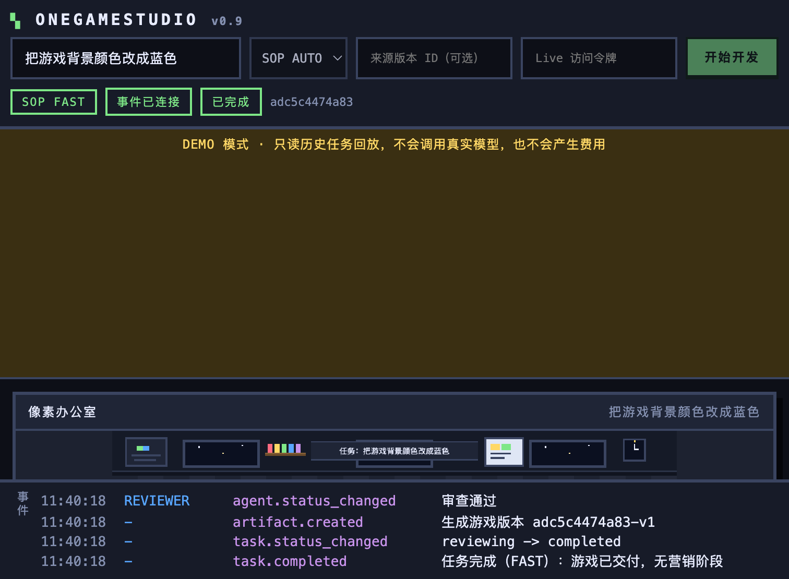
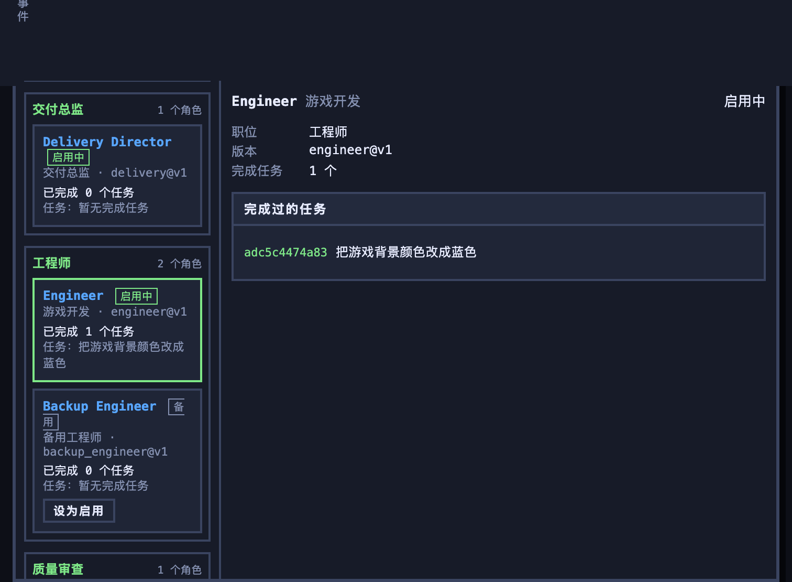

# OneGameStudio

一个可本地运行的 AI 游戏开发工作室：6 个岗位的 Agent 协作、像素办公室实时状态、
机械门禁与 AI 审查、不可变游戏版本、Talent 自进化，以及 Demo / Live 双模式。



_上：Demo 模式总览；下：Employee 面板与角色任务记录。_



## 当前状态

| 项目            | 状态                                                                                                |
| --------------- | --------------------------------------------------------------------------------------------------- |
| 本地启动        | 可用（uv + FastAPI）                                                                                |
| npx CLI         | 已提供本地 CLI；**npm 包尚未发布**，`npx onegamestudio` 需发布后才可用                              |
| GitHub 公开仓库 | 远端 `Lmliya/OneGameStudio` 当前为 **private**；阶段 10 已提交并推送（`8058ab3`），等待确认后转公开 |
| 线上部署        | **尚未部署**，无线上地址；配置与步骤已就绪，见 [部署说明](docs/deployment.md)                       |
| 测试            | `uv run pytest -q`，119 passed                                                                      |

## 功能

- **6 个岗位**：需求分析（COO）、创意总监、交付总监、工程师、质量审查、营销素材。
- **工程师双角色**：`Engineer` 与 `Backup Engineer` 共用工程师岗位，同一时间只有一个处于启用状态，可手动切换。
- **三种 SOP**：FAST / BALANCED / CREATIVE，支持手动与自动选择并记录原因。
- **Conflict Gate**：创意与交付并行提意见，COO 输出 adopt / simplify / reject 决策。
- **质量保障**：机械门禁（Playwright）+ AI 审查 + 修复循环 + 预算/并发/超时限制。
- **游戏版本**：不可变版本、父版本分支、版本切换、最终版本指针。
- **Talent 自进化**：版本、经验、提案、回归评估、用户批准与回滚；Evolution UI 目前只在 API 层保留。
- **像素办公室**：6 个工位，状态来自真实事件流，WebSocket 断线自动重连并恢复快照。
- **Demo / Live**：Demo 回放预验证历史任务，Live 才调用真实模型。

## 本地启动

要求：Python 3.12+、[uv](https://docs.astral.sh/uv/)。

```bash
uv sync
cp .env.example .env        # 默认 Demo + Mock，无需 API Key
uv run uvicorn backend.main:app --reload --port 8000
```

打开 http://127.0.0.1:8000/ 。默认 `APP_MODE=demo`、`MOCK_MODE=true`，不会调用真实模型。

### 本地 CLI

```bash
node cli/bin.js --check          # 检查环境
node cli/bin.js                  # Demo 模式，端口 8000
node cli/bin.js --port 8010 --reload
node cli/bin.js --live           # Live 模式（需要服务端密钥）
```

npm 包名为 `onegamestudio`。**本轮无法访问 npm registry，包名是否可用未经核实，包也未发布**；
`package.json` 中仍保留 `private: true` 防止误发布。发布前需要用户确认包名并移除该字段。

## Demo / Live

### Demo（默认）

- 只展示 `demo/tasks` 中随仓库提交的历史任务与 `demo/evolution` 快照。
- 顶部状态栏的 **DEMO 徽章**明确标注模式，不会调用真实模型。
- 公开部署设置 `DEMO_READ_ONLY=true` 后，创建任务返回 403。
- 详见 [docs/demo.md](docs/demo.md)。

### Live

需要服务端环境变量：

```bash
APP_MODE=live
MOCK_MODE=false
LLM_MODEL=<模型名>
LLM_API_KEY=<服务端密钥>
LLM_BASE_URL=https://api.openai.com/v1
ACCESS_TOKEN=<访问令牌>
```

限制：单 IP 频率、活跃任务上限、单任务预算、并发模型调用上限、请求超时。
未配置密钥时创建任务返回 503；令牌错误返回 401。密钥不会下发给浏览器，也不写入日志。

## 安全

- API Key 只从服务端环境变量读取，`.env` 已被 `.gitignore` 排除。
- 生成的游戏 HTML 在带 `sandbox` 与严格 CSP 的 iframe 中预览，禁止外部资源与表单提交。
- 产物接口只允许白名单文件名，任务 ID 必须是十六进制，防止路径穿越。
- Demo 只读默认关闭创建入口；Live 必须携带 `X-OGS-Token`（当 `ACCESS_TOKEN` 非空时）。
- Talent 的工具白名单、质量门禁、预算上限等受保护字段不能被自进化提案修改。

## 架构

```
frontend/            像素办公室 + 驾驶舱（原生 HTML/CSS/JS）
backend/main.py      FastAPI：任务、版本、产物、预览、WebSocket、模式控制
backend/workflow/    SOP、冲突阶段、修复循环、版本与指标
backend/core/vessel.py  Talent 执行、预算、限并发、重试、契约校验
backend/evolution/   Talent 版本、经验、提案、回归评估与职位启用
talents/*.yaml       6 个在岗 Talent + Backup Engineer
demo/tasks           预验证历史任务（Demo 只读）
demo/evolution       Demo 的 Talent 记录快照
tests/               119 个测试
```

详见 [docs/architecture.md](docs/architecture.md) 与 [docs/HANDOFF.md](docs/HANDOFF.md)。

## 测试

```bash
uv run pytest -q
node --check frontend/app.js
node cli/bin.js --check
```

## 部署

推荐 Render（Docker + 持久化 Disk）。仓库已包含 `Dockerfile`、`render.yaml`。
线上部署的平台对比、持久化、WebSocket、Playwright、费用与验收步骤见
[docs/deployment.md](docs/deployment.md)。

## 仓库发布清单

- [x] `README.md`
- [x] `LICENSE`（MIT）
- [x] `.gitignore`（排除 `.env`、`output/`、虚拟环境）
- [x] `.env.example`
- [x] `demo/` 示例数据
- [x] 测试与截图
- [x] 推送到远端（仓库当前为 private）
- [ ] 将 GitHub 仓库转为 public（等待用户确认）
- [ ] npm 包名确认与发布（等待用户确认）

## 第三方与素材

- Python / JavaScript 依赖均为开源许可，具体许可见各自发行包。
- 演示游戏由 Mock 供应商生成，单文件 HTML，不使用外部 CDN、图片、字体或音效素材。
- 仓库不包含参考项目的代码或素材；如后续引入，必须先确认许可证并在此登记。

## License

MIT，见 [LICENSE](LICENSE)。
